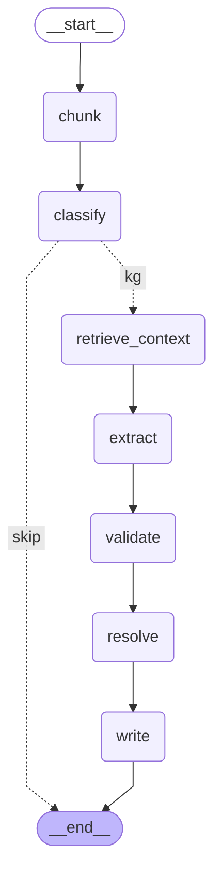

# Knowledge Graph Construction

An LLM agent built with LangGraph reads compliance documents and grows the knowledge graph
against the [ontology](ontology.md). The same pipeline handles the initial standards corpus
and any new document uploaded later, so the graph evolves without being rebuilt.

Code: [`app/construction/`](../app/construction/).

## Pipeline

| Step | What it does |
|---|---|
| `chunk` | Splits the document into numbered paragraphs (`54`, `81A`, `4.1.1`, `QC11`, `B5.4.2`), keeping heading and page. Contents pages are skipped and numbered examples stay inside their paragraph. |
| `classify` | Standard, amendment or act go on; client documents (invoices, bank statements) stop here and belong to the evidence ledger. |
| `retrieve_context` | Reads the allowed ontology codes and a snapshot of what the graph already holds for the standard. |
| `extract` | One LLM call per paragraph, returning JSON in a fixed schema: requirements, definitions, references, equations and proposals. The prompt lists what the graph already knows for that paragraph. |
| `validate` | Checks the output against the ontology: unknown codes removed, shall/may wording checked, duplicates dropped, equations with unknown line items turned into proposals. |
| `resolve` | Matches against the graph so nothing is duplicated: requirements by wording within the paragraph, definitions by term, equations by expression. |
| `write` | Validates the full write plan against the ontology, adds embeddings, and writes with `MERGE` so a document can be ingested again safely. |

## Provenance

- Every paragraph is a `Section` with its verbatim text; every chunk is a `SourceChunk` with
  file, page and embedding.
- Every extracted requirement, definition and equation has `EXTRACTED_FROM` to the exact
  chunk, plus `source` (file) and `confidence`.
- Confidence: PDF text 1.0, LLM extractions 0.8, both multiplied by OCR confidence for
  scanned documents from Component 01.

## Evolving the ontology

- New requirements and definitions attach to existing standards and paragraphs.
- Equations that use line items the ontology does not have become **proposals**
  (`label`, `name`, `reason`), collected per document for review before the schema changes.
- References in the text (`LKAS 1.25`, `paragraph 81A of LKAS 1`) become `REFERS_TO` links.

## Running it

```powershell
python -m scripts.check_llm                      # test the LLM connection on LKAS 2:9
python -m scripts.extract_preview LKAS_02_Inventories.pdf --max-chunks 5   # dry run, saves JSON
python -m scripts.ingest_all                     # all PDFs, resumable
python -m scripts.ingest_all --dry-run --max-chunks 3
```

`ingest_all` keeps `data/standards/processed/manifest.json` with the file hash and model of
every finished file. A stopped run continues where it left off; a changed PDF or a different
model runs again. A failing file is logged and the batch continues. Totals go to
`summary.json`, the log to `ingest.log`.

## API

| Endpoint | Purpose |
|---|---|
| `POST /kg/ingest/pdf` | Upload a text PDF. Returns a job (`202`). `?write=false` for a dry run. |
| `POST /kg/ingest/ocr` | Component 01 OCR output (`ExtractionResult`) for scanned documents. |
| `GET /kg/jobs/{id}` | Job status and summary: counts created and matched, issues, proposals. |
| `GET /kg/jobs` | All jobs, newest first. |
| `GET /kg/pipeline` | The pipeline as a Mermaid diagram. |

## Pipeline diagram

Generated from the LangGraph definition by `python -m scripts.export_ontology`.

<!-- generated:start -->

<!-- generated:end -->
