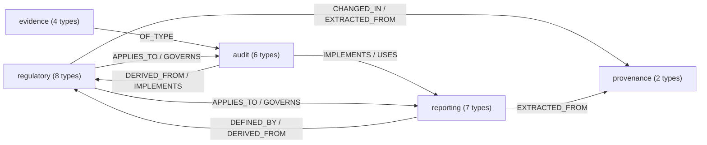
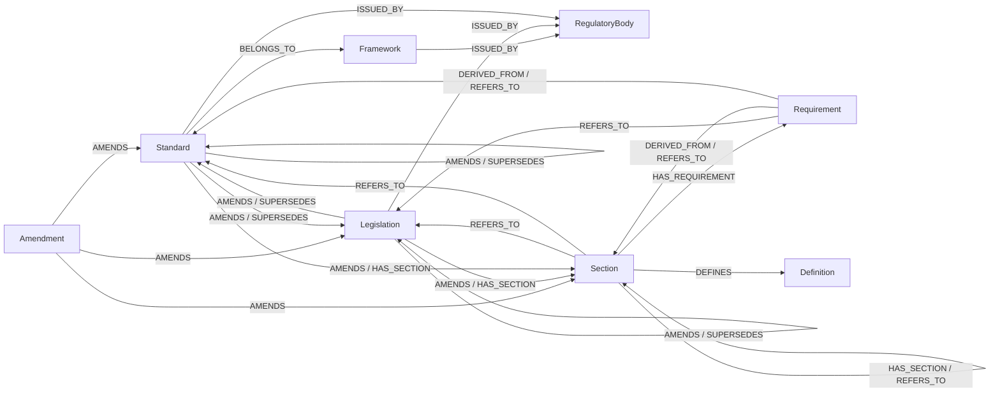
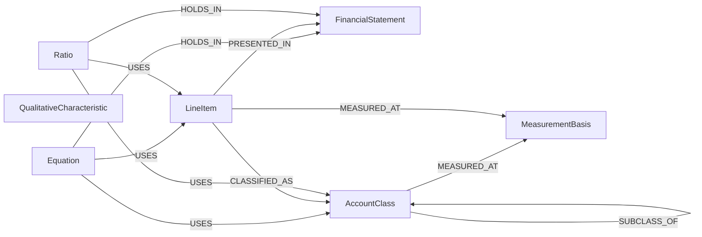
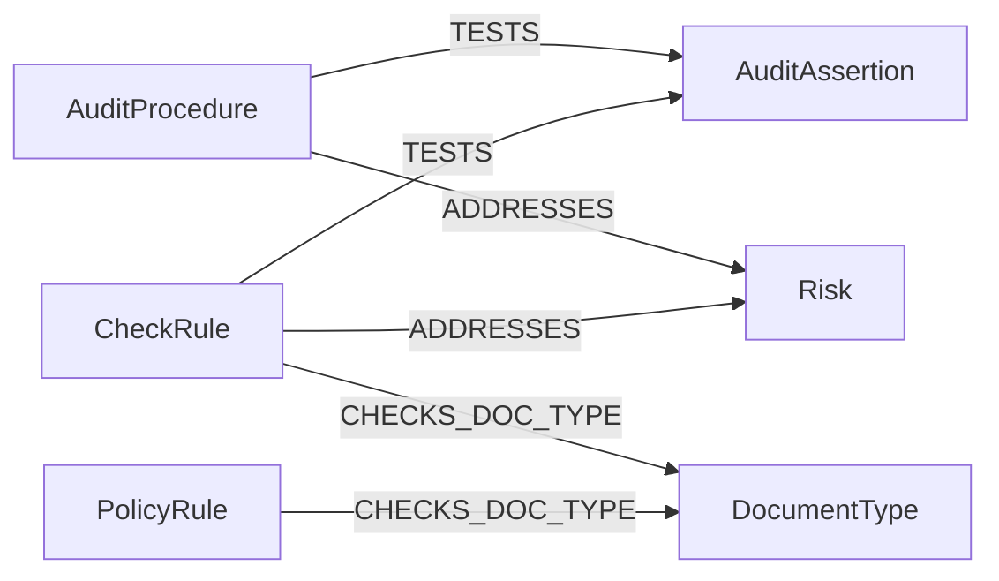
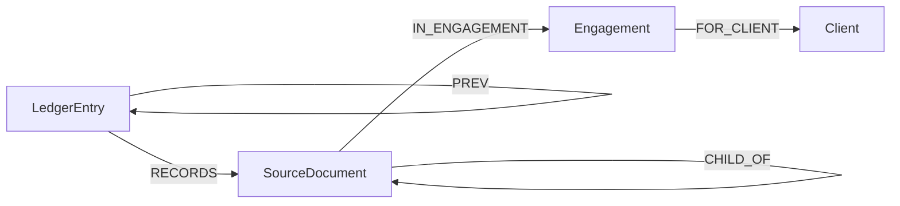
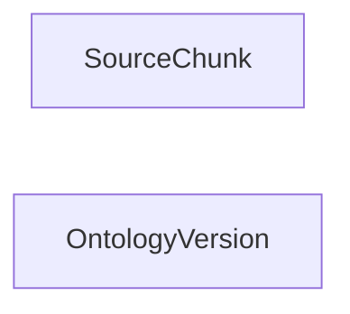

# Sri Lankan Audit Ontology

The ontology is the schema of the Component 02 knowledge graph. It defines which kinds of
nodes and relationships may exist, so that knowledge extracted from standards, client
documents and ledger entries all fit one structure that the audit agents can query.

Source of truth: [`app/ontology/schema.yaml`](../app/ontology/schema.yaml).
Seed data: [`app/ontology/seed/`](../app/ontology/seed/).

## Layers

| Layer | Holds | Built from |
|---|---|---|
| Regulatory | Regulators, frameworks, standards, paragraphs, requirements, definitions, amendments, acts | CA Sri Lanka SLFRS / LKAS / SLAuS, Sri Lankan acts |
| Reporting | Financial statements, line items, account classes, equations, ratios, measurement bases | Conceptual Framework, LKAS 1, 2, 7 |
| Audit | Assertions, procedures, risks, document types, check rules, policy rules | SLAuS 240, 315, 500, 520, 570 |
| Evidence | Clients, engagements, source documents, hash-chained ledger entries | Documents uploaded through Component 01 |
| Provenance | Text chunks and ontology versions | Ingestion pipeline |

## Design decisions

- **Sri Lankan framework, not generic IFRS.** Standards carry their CA Sri Lanka code
  (`LKAS 16`, `SLFRS 15`), Sri Lankan effective date and status. LKAS 11, 17, 18 and 39 are
  marked superseded by SLFRS 15, 16 and 9 (`SUPERSEDES`).
- **Every rule cites a paragraph.** Requirements hang off sections (`LKAS 2:9`), and
  equations and check rules link back with `DERIVED_FROM`, so a finding can be explained as
  rule → equation → paragraph → standard.
- **Authority order.** `Standard.authority` follows LKAS 8.11: specific SLFRS/LKAS first (1),
  the Conceptual Framework after (2). The CF never overrides a standard.
- **Change over time.** `Amendment` nodes record issue and effective dates and the paragraphs
  they change (`AMENDS`). Every node also stores `source`, `confidence` and `ontology_version`,
  so new documents can update the graph without losing where earlier facts came from.
- **Equations are data.** An equation stores its expression, the line items it uses with
  their side and sign (`USES {role, sign}`) and the statement it holds in (`HOLDS_IN`).
  Cross-statement checks (closing cash in the SCF equals cash in the SFP) are first class.
- **Materiality is per engagement.** CF QC11 gives no fixed threshold, so it is stored on
  `Engagement`, not on rules.
- **Fits Component 03.** Check rules use the same ids and fields as the audit agents
  (`rule_id`, `name`, `expression`, `severity`), and line items carry `aliases` for the field
  names they send (`capital` → `total_equity`).

## Example: explaining a check

```cypher
MATCH (r:CheckRule {rule_id: "CHK-011"})-[:IMPLEMENTS]->(e:Equation)
      -[:DERIVED_FROM]->(s:Section)<-[:HAS_SECTION]-(std:Standard)
MATCH (r)-[:TESTS]->(a:AuditAssertion)
RETURN r.name, e.expression, std.code, s.number, collect(a.name)
// Inventory not above NRV | inventories == min(inventory_cost, inventory_nrv) | LKAS 2 | 9 | [Accuracy, valuation and allocation]
```

## API

| Endpoint | Returns |
|---|---|
| `GET /ontology` | Full schema: layers, node types, relationship types |
| `GET /ontology/nodes/{label}` | One node type with its incoming and outgoing relationships |
| `GET /ontology/diagram?layer=` | Mermaid diagram (overview, or one layer) |
| `GET /ontology/stats` | Live node and relationship counts from Neo4j |

## Schema

Generated from `schema.yaml` by `python -m scripts.export_ontology`. Do not edit by hand.

<!-- generated:start -->
### Layer overview



### Regulatory layer

Who issues the rules and what the standards and laws say

| Node | Key | Description |
|---|---|---|
| `RegulatoryBody` | `code` | Body that issues or enforces standards (CA Sri Lanka, SEC, CBSL, IRD) |
| `Framework` | `code` | Set of standards (SLFRS, SLFRS for SMEs, SLAuS) |
| `Standard` | `code` | One accounting or auditing standard, e.g. LKAS 16, SLAuS 500 |
| `Amendment` | `id` | Change to a standard, e.g. Disclosure Initiative (Amendments to LKAS 1) |
| `Legislation` | `code` | Act or regulation, e.g. Companies Act No. 7 of 2007 |
| `Section` | `id` | Paragraph or section of a standard or act |
| `Requirement` | `id` | Single rule stated in a section |
| `Definition` | `id` | Term defined in a standard |



### Reporting layer

Financial statements, accounts and the equations between them

| Node | Key | Description |
|---|---|---|
| `FinancialStatement` | `code` | SFP, SPLOCI, SCE, SCF or Notes |
| `LineItem` | `code` | Line shown on a financial statement, e.g. Property, plant and equipment |
| `AccountClass` | `code` | Asset, liability, equity, income or expense and their sub classes |
| `Equation` | `code` | Relationship that must hold between amounts, e.g. assets = liabilities + equity |
| `MeasurementBasis` | `code` | Historical cost, current cost, realisable value, present value, fair value, NRV |
| `QualitativeCharacteristic` | `code` | Relevance, faithful representation, comparability, verifiability, timeliness, understandability |
| `Ratio` | `code` | Analytical ratio used in analytical procedures |



### Audit layer

Assertions, procedures, risks and the checks run by the audit agents

| Node | Key | Description |
|---|---|---|
| `AuditAssertion` | `code` | Management assertion tested by the auditor (SLAuS 315) |
| `AuditProcedure` | `code` | Way of collecting evidence (SLAuS 500), e.g. inspection, confirmation |
| `Risk` | `code` | Risk of material misstatement due to fraud or error |
| `CheckRule` | `rule_id` | Machine checkable rule run by the audit agents |
| `PolicyRule` | `rule_id` | Client or engagement policy with a limit |
| `DocumentType` | `code` | Kind of client document, e.g. balance_sheet, invoice |



### Evidence layer

Client documents and ledger entries that findings cite

| Node | Key | Description |
|---|---|---|
| `Client` | `id` | Audited entity |
| `Engagement` | `case_id` | One audit case for a client and year |
| `SourceDocument` | `doc_id` | Uploaded client document stored in object storage |
| `LedgerEntry` | `entry_id` | Append only record of an evidence event, hash chained |



### Provenance layer

Where extracted knowledge came from

| Node | Key | Description |
|---|---|---|
| `SourceChunk` | `id` | Text chunk of an ingested compliance document |
| `OntologyVersion` | `version` | Change log entry when the ontology or graph is updated |



### Links between layers

| Relationship | Connects |
|---|---|
| `APPLIES_TO` | Requirement → AccountClass, Requirement → LineItem, Requirement → FinancialStatement, Requirement → DocumentType |
| `CHANGED_IN` | Standard → OntologyVersion, Legislation → OntologyVersion, Amendment → OntologyVersion, Section → OntologyVersion, Requirement → OntologyVersion, Definition → OntologyVersion |
| `DEFINED_BY` | AccountClass → Definition, LineItem → Definition, FinancialStatement → Definition, MeasurementBasis → Definition, QualitativeCharacteristic → Definition |
| `DERIVED_FROM` | Equation → Standard, Equation → Section, CheckRule → Standard, CheckRule → Section, AuditAssertion → Standard, AuditAssertion → Section, AuditProcedure → Standard, AuditProcedure → Section, Risk → Standard, Risk → Section, MeasurementBasis → Standard, MeasurementBasis → Section, QualitativeCharacteristic → Standard, QualitativeCharacteristic → Section |
| `EXTRACTED_FROM` | Standard → SourceChunk, Legislation → SourceChunk, Amendment → SourceChunk, Section → SourceChunk, Requirement → SourceChunk, Definition → SourceChunk, Equation → SourceChunk, Ratio → SourceChunk |
| `GOVERNS` | Standard → AccountClass, Standard → LineItem, Standard → FinancialStatement, Standard → DocumentType |
| `IMPLEMENTS` | CheckRule → Equation, CheckRule → Requirement |
| `OF_TYPE` | SourceDocument → DocumentType |
| `USES` | CheckRule → AccountClass, CheckRule → LineItem |
<!-- generated:end -->
